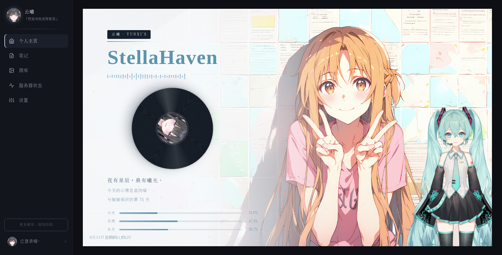
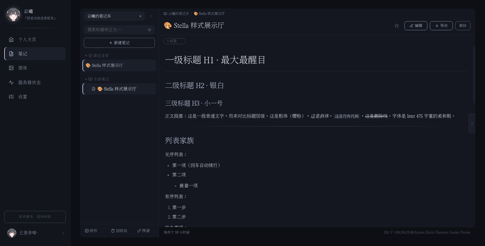
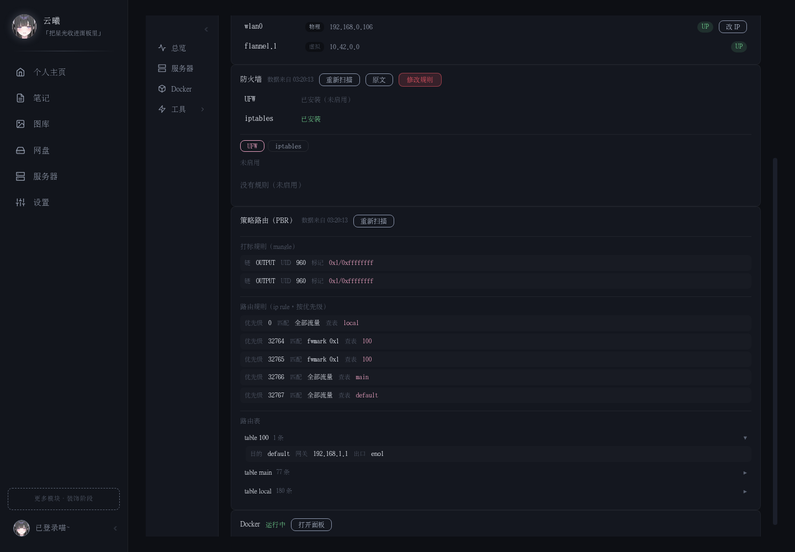

# StellaHaven

> 一个自托管的个人数字空间，把笔记、文件入口、个人主页和服务器运维放在同一处。

<div align="center">
  
  
</div>

最初是存放笔记和图库的 Flask 原型，后来重写为 FastAPI + Vue 3。现在既用于整理内容，也用于连接独立服务、观察服务器和处理日常运维。

## 功能

### 笔记与知识整理

- 工作区、层级目录、面包屑、标签、双链 `[[链接]]`、反向引用和关系图谱。
- Markdown 源码与富文本编辑、实时预览、代码高亮和 Mermaid 图表；支持 Markdown / HTML / PDF / PNG 导出。
- 正文自动保存、草稿、历史版本、差异比较与回收站；历史恢复检查管理权限和并发修改。
- Markdown、TXT 和 ZIP 导入，预览目录结构并映射相对链接、图片和附件，不覆盖已有笔记。
- 模板复用、统一搜索、快捷记录，以及笔记、节点、任务和告警之间的关联时间线。
- WebSocket 在线状态、编辑状态与文档变更通知。它提供多设备感知和冲突处理，不是逐字合并的多人协同编辑。

### 主页与网站入口

- 图片 / 视频背景、签名卡、心情便签、时光进度、每日塔罗，以及 Live2D / 3D 挂件。
- 主题、导航名称、图标、顺序和显隐可配置，网站连接与自定义代码集中管理。
- 网站可使用 iframe、外链或独立 origin 代理；目标站 CSS / JavaScript 支持草稿、应用与回退。
- OpenList 提供网盘，Immich 提供图库；Stella 整合入口、外观和认证流程，不替代它们的存储引擎或原生客户端。
- 可选网站现场缓存与笔记缓存分开，缓存不会延长登录或管理授权。

隔离代理的上游经过校验和固定，不提供任意 URL 的开放代理。网站返回响应头不等于实际可嵌入或登录；独立域名、TLS、反向代理和 OIDC 回调需要部署者配置。

### 服务器与网络

节点运行单文件 Python Agent，主动上报、领取任务并回传结果，适合 NAT 后的被管理设备。

- 系统指标、网卡流量与历史图表，按需读取硬件概览；缺失指标保留未知，不用零值冒充。
- 服务器地图、服务监控与 WireGuard 连通状态。
- iperf3 打流、MTR 路径诊断、远程命令、Docker 状态和日志，以及防火墙 / 策略路由检查。
- 节点离线、监控异常等告警，配合站内通知和可选邮件通知。
- 上报失败后有界内存积压，恢复连接后补传；这不是重启后仍可靠保留的持久日志。
- Agent 仅升级到更高规范版本，校验公告中的大小、SHA-256 和脚本预加载，保留回退文件。中心服务与 HTTPS 仍是信任根，不是独立发布签名体系。

Agent 可在 Linux、Windows 和飞牛OS运行，但高权限网络管理、组件安装和传感器支持并不跨平台等价。命令执行和网络配置需要明确授权，不应将固定语法 helper 理解为整个系统均已实现最小权限。

<div align="center">
  
</div>

### 账号与会话

- 单用户初始化，支持用户名 / 昵称 / 已验证邮箱登录，以及邮箱验证码登录、日常密码恢复。
- 日常登录与独立管理密码分离；敏感配置、恢复及运维操作由服务端检查管理授权。
- HttpOnly Cookie、短效访问 JWT、刷新令牌旋转与吊销；资源按身份过滤。
- 记住登录时采用绝对期限，否则按真实交互计算空闲期限。后台轮询与刷新不会无限延长会话。
- 浏览器会话、Agent Bearer 和 OIDC 客户端使用不同凭证与权限边界，不能互换。


## 设计与技术栈

| 部分 | 实现与用途 |
|---|---|
| 后端 | Python 3.13+、FastAPI；前端构建、API 和 WebSocket 同端口托管 |
| 数据 | PostgreSQL、SQLAlchemy 2、Alembic；正文、历史与配置使用明确模型和迁移 |
| 前端 | Vue 3、TypeScript、Vite、Pinia |
| 编辑与展示 | CodeMirror 6、Milkdown、marked、DOMPurify、Mermaid、d3-force |
| 图表与挂件 | ECharts、Pixi / Live2D、three.js |
| 节点 | Python、psutil、httpx；部分任务依赖系统组件 |
| 验证 | pytest / httpx、Vitest、Playwright、独立 PostgreSQL |
| 构建与发布 | uv、npm 锁文件、Docker、GitLab CI；GitHub Actions 验证镜像分支源码 |

正文、草稿与版本分开，避免把自动保存误当成无冲突覆盖；日常阅读和管理操作分权，避免长期持有运维权限；外站代码在目标入口运行，不注入主站身份。

## 本地开发

准备 Python 3.13+、Node.js 22.12+ 和预先创建的专用开发 PostgreSQL 数据库与角色。下面的迁移命令只用于开发库，不受测试目标 guard 保护，不要指向生产数据库。

```bash
git clone https://github.com/Yunxi-Yaoyao/StellaHaven.git
cd StellaHaven
uv sync --frozen --all-groups

export POSTGRES_HOST=127.0.0.1
export POSTGRES_PORT=5432
export POSTGRES_USER=stella_dev
export POSTGRES_PASSWORD='<开发库口令>'
export POSTGRES_DB=stella_dev
export STELLA_MAIN_ORIGIN=http://localhost:5173
export STELLA_TRUSTED_ORIGINS=http://localhost:5173,http://localhost:12031
export STELLA_COOKIE_SECURE=false

uv run alembic upgrade head
uv run uvicorn main:app --reload --host 127.0.0.1 --port 12031
```

另开终端启动前端：

```bash
cd StellaHaven/frontend
npm ci --ignore-scripts --include=dev
npm run dev -- --host 127.0.0.1
```

访问 `http://localhost:5173`，接口文档位于 `http://localhost:12031/docs`。首次初始化账号后设置独立管理密码；邮箱功能另配 SMTP，外部网站与 OIDC 另配连接和回调。

`STELLA_*` 配置在启动后端的终端中显式导出，不能假设 Pydantic 读取 `.env` 就会自动写入进程环境。`STELLA_COOKIE_SECURE=false` 仅用于本地 HTTP；生产使用 HTTPS 并持久保存数据库与认证密钥，不能多节点各自生成不同密钥。

## 构建与部署

```bash
cd frontend
npm ci --ignore-scripts --include=dev
npm run build
```

该命令同时运行 TypeScript 检查和 Vite 构建，生成 `frontend/dist`，由 FastAPI 托管。它不是生产发布命令。

```text
浏览器 → HTTPS / 反向代理入口
             └─ 健康检查 → 具有可写主角色的应用 → PostgreSQL
                              备用应用 / 数据库复制 / 仲裁
```

主备模式通过 `/ready-primary` 检查有效角色和数据库可写性；共享状态与 blob 的 PostgreSQL 存储模式需按部署配置启用。应用更新、数据库迁移、角色切换和入口变更是不同操作，不用一次服务重启代替。

发布实现见 `deploy/local-ha/production_release.py` 和 `deploy/local-ha/node_production.py`，以相应提交的 CI rules、镜像 digest、迁移及权限校验为准。部署说明中的旧入口、Agent 版本和自动发布记录不应直接当作当前环境配置；`deploy/k8s/` 保留历史方案。核心主备也不自动涵盖公网入口、外部文件服务和全部故障场景。

节点纳管从服务器管理页取得安装命令；仅从可信 HTTPS 获取脚本并审阅。运行凭据使用受限文件，含 Token 的安装命令仍不应进入公开日志或 Git。脚本版本、服务端允许公告的版本与节点实际安装版本分别核对。

## 开发中的新增模块

以下功能已进入后续开发候选，**尚未随本 README 合入当前主分支代码**，不是默认克隆即可使用的功能：

| 模块 | 范围 |
|---|---|
| 网页项目 | HTML 转普通笔记，或保留 HTML/CSS/JavaScript/资源；文件树、源码编辑、手动刷新与隔离运行 |
| 网页运行进度 | 按账号和项目同步适配后的 localStorage，不覆盖 IndexedDB、Cookie 或整个浏览器状态 |
| 备份中心 | 设置 / 全部数据两类 ZIP、计划、下载与校验；设置恢复和维护窗口中的离线全量恢复分开 |
| 内置文档中心 | `/help` 使用指南、API 和数据模型参考，与 FastAPI `/docs` 分工 |
| 阅读与模板 | 目录式模板、账号阅读偏好、外观和布局同步 |
| 网站入口 | 对已部署的公私入口选择连接路径，不自动创建 DNS、TLS 或 SSO 回调 |

备份不包含外部 OpenList / Immich 的文件与照片，ZIP 本身不加密；新增模块需随代码、迁移和对应入口配置发布。开发能力不等于已在所有部署环境启用。

## 测试与文档

GitHub Actions 的后端测试与前端构建只代表其所在镜像分支；GitLab 另有项目门禁和生产发布流程。测试资源与部署凭据分离，构建成功不等于已发布。

不同测试目录有各自的数据库、浏览器与进程夹具，不把所有目录一次混跑。按当前分支的 CI 配置及各模块说明准备隔离资源，不向生产库执行测试或关闭目标校验。

- [笔记目录与导入](docs/notes-import-and-templates.md)
- [会话寿命与活动上报](docs/session-policy.md)
- [硬件采集与平台差异](docs/hardware-monitoring.md)
- [Agent 更新机制](deploy/agent-privileges/SELF-UPDATE.md)

```text
app/                  路由、服务、仓储、模型与权限
frontend/src/         笔记、主页、服务器与设置
agent/                采集、任务执行与安装器
alembic/              数据库迁移
deploy/               镜像、主备、入口与权限配置
tests*/ frontend/e2e/ 隔离回归和浏览器检查
docs/                 设计、协议与维护记录
```
