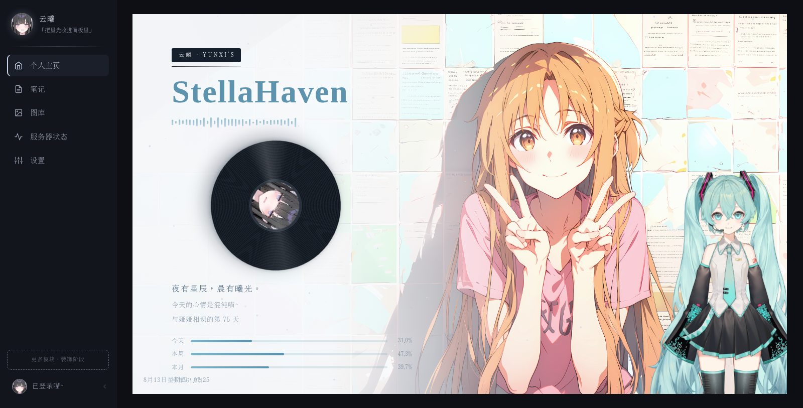
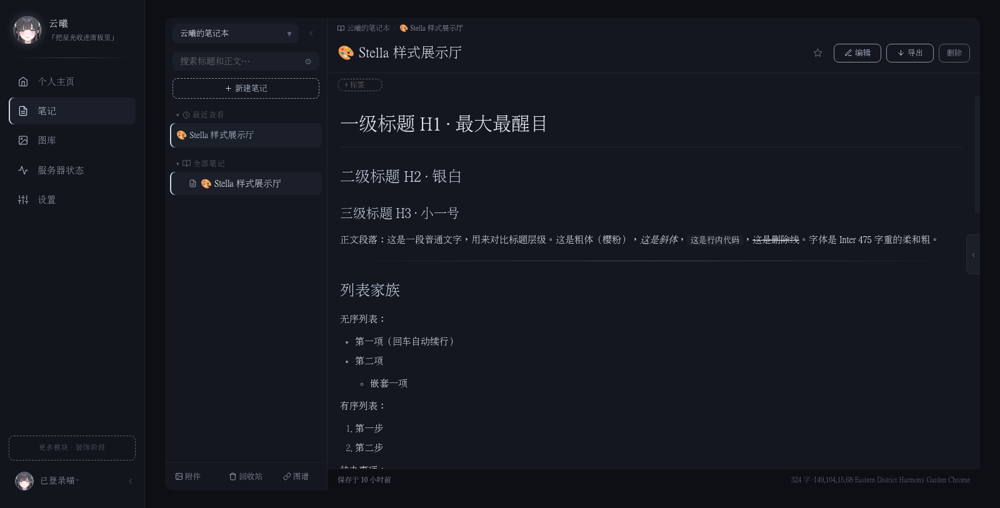
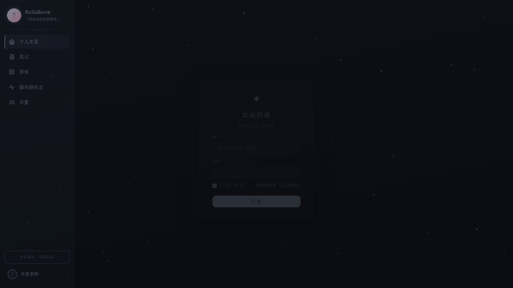
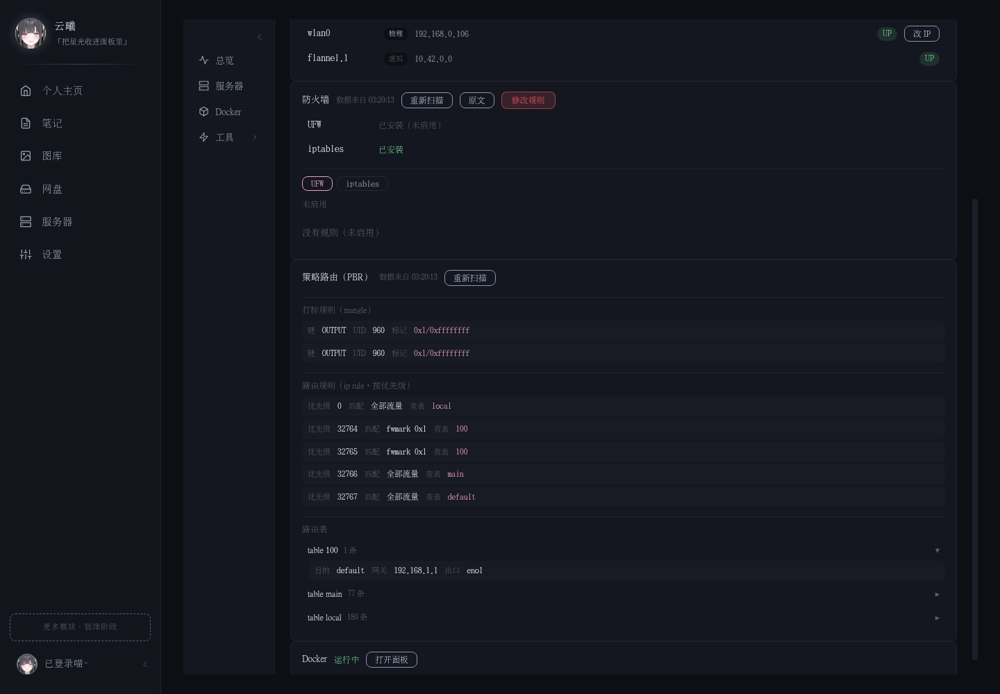

# StellaHaven ✨

> 个人数字空间：笔记、图库、网盘、主页挂件、多服务器监控，带一套自实现的账号体系。

<div align="center">
  
  
</div>

---

## 项目历程

最初是 Flask 前后端混合的原型，用于放笔记和图库。之后整体重写为 FastAPI + Vue 3，逐步补齐账号权限、测试与 CI，随后加入了服务器监控模块（agent 采集 + 任务下发）和网盘/图库的嵌入式整合。

## 功能与设计

### 账号体系

认证授权不依赖第三方框架，全部直接实现，便于完全掌控会话行为：

- **三合一登录**：用户名 / 昵称 / 已验证邮箱任一可登
- **免密验证码登录** + 忘记密码重置
- **JWT（httpOnly cookie）+ refresh token 旋转**：访问令牌 30 分钟短效；刷新令牌哈希落库、可吊销、多端并存
- **会话看门狗**：30s 巡检，被吊销的会话即时踢下线
- **邮箱验证**：SMTP 验证码，10min 有效期 + 5min 重发限流
- **单用户身份**：仅首次初始化创建唯一账号；邀请和用户管理入口关闭，原用户 ID 与数据归属保持不变
- **独立管理密码**：日常登录不自动提权；关键操作使用独立 Argon2id 管理密码，服务端会话授权默认十分钟。保护默认开启，关闭或改密需再次验证，关闭后登录态可直接管理
- **验证码预算**：单码最多五次错误，全账户共享失败/发送窗口；邮箱恢复仅修改日常密码，不重置管理密码
- **全站标识互斥**：用户名 / 昵称 / 邮箱交叉查重

<div align="center">
  
</div>

### 数据归属与恢复

- workspace / document / attachment / tag / link / version 全部按当前用户过滤
- 资源不存在或无权限时统一返回 404，**不暴露资源存在性**（防探测）

### 笔记

- 层级树 + 折叠状态记忆 + 面包屑导航
- 双链 `[[]]` 自动补全 + 反链面板
- 关系图谱（d3-force 力导向图）
- 标签、附件（粘贴上传 + 引用计数清理）
- 自动版本检查点、差异比较、提权且带乐观锁的恢复；回收站与草稿槽
- Ctrl/Cmd+K 统一搜索、工作区快捷记录收件夹，以及节点/告警/任务/笔记关联时间线
- CodeMirror 6 编辑器 + 实时预览 + PDF / HTML / PNG 导出

### 主页

- 签名卡 + 塔罗每日一抽（日期做随机种子，同一天恒定同一张）
- Live2D 挂件（点击互动）+ 3D 挂件（three.js）
- 三套主题（破晓 / 夜泊 / 海岸线）
- 时光进度条、心情便签、自定义背景（图片 / 视频）

### 导航与网站接入

设置统一在“资料与安全 / 导航与网站 / 服务与通知 / 性能与数据”四分类。

- 导航支持名称、图标、显隐、顺序、恢复默认，配置进入 PG；底部账号入口始终可找回设置。
- 网站支持直连 iframe、外链、OpenList 兼容路径及独立 origin 根代理。固定上游在同一设置页解析、明确批准并冻结 IP；运行时 socket pin，不提供任意 URL 开放代理。
- CSS/JS 草稿、语法检查、主动应用、上一版回退；目标 origin 执行，不在主页面执行。跨域 iframe 不凭 load 或健康检查声称 ready。
- 可选网站现场缓存，最多三项 LRU，笔记缓存独立；关闭/隐藏/退出会清理，缓存不延长登录或管理授权。
- OpenList 保留主题、目录缓存及布局修复，由响应层去重并加载集中配置；写操作仍校验当前管理授权，缓存 Token 不能绕过锁回。
- Immich 保留独立域名、原账号和已有 OIDC。其自身发起 OAuth state/PKCE 流程；图库 head loader 可读取集中发布的目标站代码，不接管原移动 App API。入口加载器和独立代理域名需一次部署，设置保存不冒充部署完成。

### 服务器监控

多节点纳管，采用 **agent 拉取模型**而非服务端推送：

- **单文件 agent**（`agent/stella_agent.py`，仅依赖标准库 + psutil + httpx，跨 Linux / Windows / 飞牛OS）：被控机只需跑一个脚本，无需在服务端打通到被控机的连接——agent 主动轮询拉任务、主动上报数据，天然穿透 NAT / 防火墙
- **采集**：5s 上报网卡流量（上报即心跳）、60s 上报系统指标；上报失败时数据压内存队列（24h 上限），恢复后按序补传
- **任务下发**：打流（iperf3）、MTR 路由追踪（五类型 × 三触发：手动 / 定时 30min / 失败防抖 10min）、远程命令、防火墙/PBR/Docker 扫描——全部走「服务端建任务 → agent 轮询领取 → 执行 → 回传结果」
- **惰性扫描缓存**：扫描类数据（防火墙规则 / PBR 策略路由 / Docker 容器）读最近一次快照，超过 10 分钟自动后台重扫 + 手动刷新按钮——不设服务端定时任务
- **组件代装**：iperf3 / speedtest / mtr / ufw / docker 缺失时可远程安装；Docker 面板使用固定语法 root-owned helper。网络管理与管理员授权命令仍具备较强权限，不宣传全局最小权限
- **自更新**：agent 每 300s 对比服务端版本号，不一致则拉新脚本原地替换重启
- **改 IP 带回滚**：改网卡地址后用 `ping -I <iface>` 验证连通性，不通自动回退（用 root 权限 ping 是为了绕开本机 PBR owner-mark 对 agent 进程的路由劫持）
- **Docker 面板**：容器竖向卡片 + 日志查看（tail ≤500）+ inspect 配置摘要（白名单字段）
- **PBR 结构化**：`ip rule` / 路由表 / iptables mangle 打标链解析为结构化三段展示，而非原始文本

<div align="center">
  
</div>

### WebSocket 与多设备编辑状态

- 在线状态感知（presence）、编辑中状态、文档变更广播

## 技术栈

| 层 | 技术 |
|:--|:--|
| 后端框架 | FastAPI |
| ORM | SQLAlchemy 2.0 |
| 数据库迁移 | Alembic |
| 数据库 | PostgreSQL |
| 认证 | JWT（HS256）+ refresh 旋转 + argon2 密码哈希 |
| 实时 | WebSocket |
| 前端 | Vue 3 + TypeScript + Vite |
| 状态管理 | Pinia |
| 编辑器 | CodeMirror 6 + marked |
| 图谱 | d3-force |
| 挂件 | pixi-live2d-display / three.js |
| 导出 | html2canvas + jsPDF |
| 节点采集 | 单文件 Python agent（psutil + httpx） |
| 嵌入式服务 | OpenList（网盘）/ Immich（图库），Docker 部署 |
| 测试 | pytest + httpx；真实 PG、媒体、并发与部署边界回归 |
| CI/CD | GitLab（生产发布）＋ GitHub Actions（源码镜像验证） |
| 包管理 | uv |

## 部署

### 当前生产架构

前端构建产物仍由 FastAPI 单端口托管，API、WebSocket 与页面保持同源。业务运行于两个独立主备节点，不依赖 Kubernetes 控制面才能切换。

```text
浏览器 → HK nginx / frps
            ├─ Nyarch 专用 frpc → 本机应用 :25131 → 本机 PG :24532
            └─ NAS 专用 frpc    → 本机应用 :25131 → 本机 PG :24532
                              PostgreSQL 同步复制
              etcd：Nyarch + NAS + 上海第三仲裁
```

- 只有持有效主角色且本机数据库可写的应用通过 `/ready-primary`；备用应用拒绝业务写入。FRP 使用 HTTP 健康检查，不把 TCP 端口可达当作主库资格。
- 两节点各自持久化 PGDATA。附件、头像、背景与动态配置统一进入 PG 事务及复制链路；固定模型资源按清单双端预置，本地缓存可重建，运行时不共挂 NAS NFS。
- 正常同步复制；备用不可用时可按非严格同步策略降级为单节点写入。恢复节点先追平、不自动抢主。网络分区验收与硬件 fencing/宿主冻结保证是不同边界。
- 本地稳定数据库入口为写 `24533` / 读 `24534`；开发后端 `12031` 连接独立的 `stella_dev` 库，生产使用 `stella`。
- GitLab 的 protected master 运行测试、构建不可变 digest，并先更新备用应用、再更新活动应用。镜像/数据库迁移版本、资源和密钥指纹不一致时拒绝发布；CI 不重启 PG、不自动切换数据库角色。
- OpenList、Immich、邮件及香港公网入口仍是独立服务，不能因核心主备部署而视为全部实现了容灾。

生产发布变量、受限 SSH、回退和操作边界见 [生产发布说明](deploy/local-ha/PRODUCTION_README.md)。旧 `deploy/k8s/` 保留作历史与回退参考，不是当前生产启动入口。

### 本地开发

```bash
# 1. 克隆
git clone git@github.com:Yunxi-Yaoyao/StellaHaven.git
cd StellaHaven

# 2. 装后端依赖（需要 Python 3.13+）
uv sync

# 3. 配环境变量（创建 .env）
cat > .env <<EOF
POSTGRES_HOST=localhost
POSTGRES_PORT=5432
POSTGRES_USER=your_user
POSTGRES_PASSWORD=your_password
POSTGRES_DB=stella
STELLA_TRUSTED_ORIGINS=http://localhost:5173,http://localhost:12031
STELLA_MAIN_ORIGIN=http://localhost:5173
STELLA_COOKIE_SECURE=false  # 仅本地 HTTP 开发；生产必须 true
EOF

# 4. 跑数据库迁移
uv run alembic upgrade head

# 5. 启动后端
uv run uvicorn main:app --reload --port 12031

# 6. 启动前端（另开终端）
cd frontend
npm install
npm run dev
```

启动后访问 `http://localhost:5173`（前端）和 `http://localhost:12031/docs`（API 文档）。

> 首次启动创建唯一账号，然后在“设置 → 资料与安全”初始化独立管理密码。数据库口令没有源码默认值，必须通过环境或受控密钥文件提供。生产 JWT/数据库/OIDC 密钥需按双端发布协议预置，不在运行时随意重生成。

### 生产构建

```bash
cd frontend && npm install && npx vite build   # 产物输出到 frontend/dist
systemctl restart stella-backend               # 后端直接托管 dist，无需单独前端服务
```

> 构建配置里固定了 `cssTarget: "chrome90"`——避免压缩器把 `@media (max-width:768px)` 改写成 range 语法（`(width<=768px)`），旧版 WebView（如部分手机浏览器内核）无法解析会整段丢弃，导致移动端适配失效。

### 纳管新节点

在“服务器 → 节点”完成管理提权后添加节点，通过受控安装命令接口显式取得安装凭据，再运行 `agent/install.sh`。Linux 安装器使用 root-only EnvironmentFile，不把 Token 留在 ExecStart 参数中。Agent 0.6.10 使用 Bearer/JSON；在全节点 helper 准备好之前，通过发布变量暂停版本公告，保留旧协议的限期兼容与日志脱敏。

## 目录结构

```
StellaHaven/
├── app/
│   ├── config.py          # 配置（pydantic-settings，读 .env）
│   ├── database.py        # engine / session / Base
│   ├── security.py        # 密码哈希 + JWT 签发校验
│   ├── models/            # SQLAlchemy 模型
│   ├── schemas/           # Pydantic 请求/响应模型
│   ├── routers/           # API 路由（auth/document/workspace/ws/monitor/drive/gallery/...）
│   ├── services/          # 业务逻辑
│   └── repositories/      # 数据访问层
├── agent/                 # 节点采集 agent（单文件 + install.sh）
├── frontend/              # Vue 3 + TypeScript + Vite
│   └── src/
│       ├── modules/       # 按域拆分（auth/notes/home/drive/gallery/servers/settings）
│       ├── shell/         # 侧栏等外壳组件
│       ├── api/           # 前端 API 封装
│       └── stores/        # Pinia 状态
├── deploy/                # CI、独立主备发布及外部服务配置
├── alembic/               # 数据库迁移
├── tests/                 # pytest／隔离 PG 与媒体回归
└── .github/workflows/     # CI（push/PR 自动跑测试）
```

## 测试 & CI

- **后端与集成回归用例**，覆盖认证、文档、工作区、标签、附件、回收站、版本、图谱等模块
- **CI/CD**：GitLab 承担受保护主分支的生产发布；GitHub Actions 验证镜像代码，不部署生产。测试使用独立 PostgreSQL 服务。

```bash
uv run pytest tests tests_ha  # 先配置专用测试 DSN，guard 拒绝生产目标
# SQLite/协议测试必须分进程：各 tests_isolated 文件使用 --noconftest
# tests_notes_upgrade、tests_builtin、tests_iframe_cache 也按各自夹具独立运行
```

## 路线图

- [x] 账号体系 + 数据隔离
- [x] 笔记（双链 / 图谱 / 版本 / 回收站）
- [x] 主页（Live2D / 塔罗 / 主题）
- [x] WebSocket 实时协同
- [x] 网盘 / 图库嵌入式整合（OpenList / Immich）
- [x] 服务器监控（agent 采集 / 任务下发 / MTR / 打流 / 防火墙与 PBR / Docker 面板）
- [ ] 防火墙写操作（规则增删 + 校验回退）
- [ ] 移动端适配完善
- [x] Docker 镜像与受控主备应用发布；集群初始化和数据库迁移另行验收
